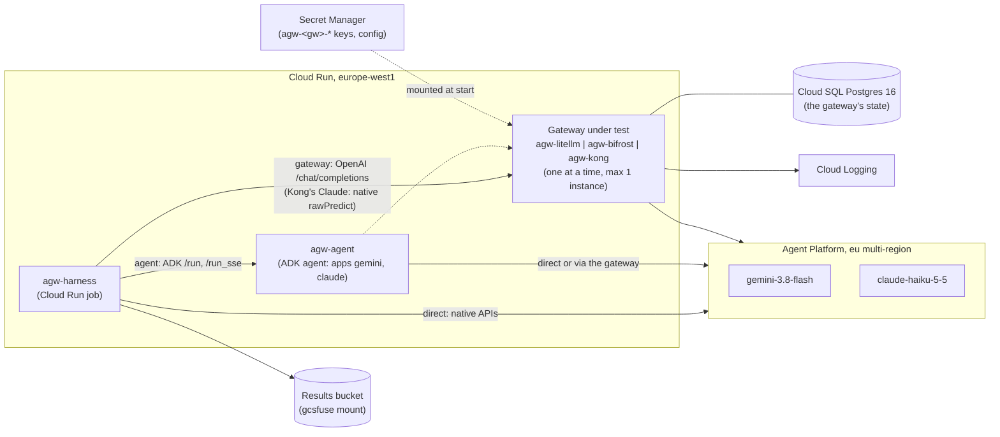
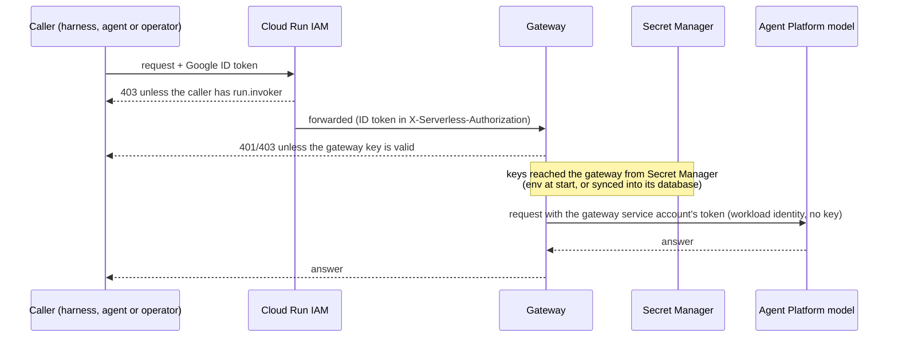

# Architecture

How the lab is laid out on GCP: what runs where, how requests and credentials flow, and which Terraform stack owns what. The decisions behind it are in [decisions/](decisions/README.md); each gateway's internals are in `gateways/<gw>/NOTES.md`.

Everything is in one GCP project, in `europe-west1` (Belgium). The models are called on the Agent Platform's `eu` multi-region endpoint (`aiplatform.eu.rep.googleapis.com`), because Claude Haiku 5.5 has no single-region endpoint in Europe ([ADR 0002](decisions/0002-region-and-model-endpoints.md)). Only one gateway is deployed at a time.

## Components

The **harness** is a Python load generator ([ADR 0006](decisions/0006-harness-design.md)) run as a Cloud Run job next to what it measures. The **agent** is a small ADK agent serving two apps, `gemini` and `claude`, from one image; an environment variable (`AGW_TARGET`) points it at the models directly or at the current gateway, and its code never changes ([ADR 0003](decisions/0003-agent-on-cloud-run.md)). The **gateway** is an upstream OSS image, configured and deployed by this repo.

## Measured paths

| Harness target | Path | Request format |
| --- | --- | --- |
| `direct` | harness → model | Native APIs: Gemini `generateContent`, Claude `rawPredict`. Any translation a gateway does therefore counts as its overhead |
| `agent` | harness → agent → model, or → agent → gateway → model | ADK `/run` and `/run_sse` |
| `gateway` | harness → gateway → model | OpenAI `/chat/completions` (Kong's Claude route takes the native Vertex format; [ADR 0014](decisions/0014-kong-claude-path-and-keys.md)) |

Every gateway run is paired with `direct` in the same job, the two targets taking turns in ABBA-ordered blocks, because Gemini's latency drifts by seconds between runs ([ADR 0007](decisions/0007-paired-baselines.md)). Thinking is a fixed condition as requested: Gemini `LOW` (sent through gateways as `reasoning_effort`), Claude off ([ADR 0005](decisions/0005-thinking-fixed-test-condition.md)). Whether a gateway honours it is a finding: Kong drops `reasoning_effort`, so its Gemini measurements include default-level thinking (`gateways/kong/NOTES.md`).

## Identity and access

Two checks stand between a caller and a model, and the gateway authenticates to the model with its own identity:

- **Callers to Cloud Run.** Every service URL is public but IAM-authenticated: a caller needs `roles/run.invoker` and sends an ID token; anything else is refused before the container sees it ([ADR 0008](decisions/0008-gateway-access-and-litellm-state.md)).
- **Callers to the gateway.** Past Cloud Run, each gateway knows a caller only by its key: one per caller (`agw-<gw>-agent-key`, `agw-<gw>-harness-key`), stored in Secret Manager. Each caller's service account can read only its own key; the gateway's account can read all of its `agw-<gw>-*` secrets.
- **Gateway to model.** Workload identity: the gateway's service account calls the Agent Platform with its own token. No model API key exists.

| Service account | Runs | Roles |
| --- | --- | --- |
| `agw-agent` | the agent | `aiplatform.user`, `logging.logWriter`; `run.invoker` on the gateway; read on its own gateway key |
| `agw-harness` | the harness job | `aiplatform.user`, `logging.logWriter`; object user on the results bucket; `run.invoker` on the agent and the gateway; read on its own gateway key |
| `agw-gw-<gw>` | each gateway | `aiplatform.user`, `logging.logWriter`; `secretAccessor` only on secrets named `agw-<gw>-*` (an IAM condition); `cloudsql.client` on its own Cloud SQL instance only (LiteLLM and Bifrost) |
| `agw-build` | Cloud Build | writer on the image repo, reader on the build source bucket, log writer |

`aiplatform.user` is project-wide: the Agent Platform has no per-model IAM. IAM in the project is additive and every name is prefixed `agw-`, because the project may hold other work.

## The gateways

All three share one shape: an upstream OSS image pulled through an Artifact Registry remote repository and deployed by digest; one Cloud Run instance (1 vCPU, min 0, max 1), so limits kept in memory aren't split across instances (bursts can still overshoot them: `results/summary.md`, test 3); Cloud SQL Postgres 16 for keys and state; config and keys from Secret Manager; Cloud Run IAM in front.

| | LiteLLM | Bifrost | Kong OSS |
| --- | --- | --- | --- |
| Release tested | v1.103.2 | `transports/v2.2.6` | 3.9.3 |
| Image pulled through | `agw-ghcr` | `agw-ghcr` | `agw-dockerhub` |
| Config | `config/config.yaml`, mounted from Secret Manager | `config/config.json`, mounted from Secret Manager ([ADR 0013](decisions/0013-bifrost-state-and-keys.md)) | `config/kong.yaml`, synced into Postgres by decK (`make sync-kong`; [ADR 0015](decisions/0015-kong-postgres-and-deck.md)) |
| State in Postgres | keys, budgets, spend log | config store and logs store | entities (routes, plugins, consumers, keys) |
| Database connection | Cloud SQL connector, `/cloudsql` socket | Cloud SQL connector, `/cloudsql` socket | TCP to a private IP over Direct VPC egress ([ADR 0016](decisions/0016-private-network-for-gateway-databases.md)) |
| Caller keys | minted by hand after deploy | generated by Terraform | generated by Terraform, written into Kong by decK |
| Claude path | OpenAI format, translated | OpenAI format, translated | native Vertex `rawPredict` pass-through |
| Admin UI | LiteLLM UI | Bifrost UI | Kong Manager OSS at `/manager` |

The admin UIs are reached with `gcloud run services proxy`, which adds the operator's ID token; run it on the machine with the browser (`make ui-<gw>` runs it on the workstation, for `curl`), because a remote IDE's port forwarding breaks UIs with absolute paths. Behaviour tests that need extra config (failover, guardrails, stored prompts) run in short **test windows**: a `TEST ONLY` config is deployed or synced, used, and removed ([ADR 0010](decisions/0010-behaviour-tests-config-windows.md)).

## Network

The agent, the harness, LiteLLM and Bifrost use Cloud Run's default egress. LiteLLM's and Bifrost's databases have a public IPv4 (encrypted connections only) reached through the Cloud SQL connector, which authorises by IAM. Kong's init phase can't open a Unix socket, so `foundation/` also holds a VPC for gateway databases, and Kong uses Direct VPC egress with `PRIVATE_RANGES_ONLY`: database traffic enters the VPC, model calls leave Cloud Run as before ([ADR 0016](decisions/0016-private-network-for-gateway-databases.md)):

- `agw-vpc`, subnet `agw-run-europe-west1` for Cloud Run Direct VPC egress, no default route.
- Private services access (`10.20.0.0/20`) peered to Cloud SQL; Kong's database has a private IP only.
- Firewall: deny all ingress except IAP TCP forwarding on port 22.

## Terraform stacks

Each stack has its own state prefix in a GCS bucket that `foundation/` creates.

| Stack | Lifetime | Owns |
| --- | --- | --- |
| `foundation/terraform` | the whole project | APIs; budget and alert; service accounts and project IAM; state bucket; image repo `agw-images` and the remote repos `agw-ghcr` and `agw-dockerhub`; build source bucket; results bucket; `agw-vpc` and private services access |
| `agent/terraform` | the whole project | `agw-agent` Cloud Run service; who may invoke it; its target (`direct` or a gateway URL and key secret) |
| `harness/terraform` | the whole project | `agw-harness` Cloud Run job, the results bucket mount; its gateway URL and key secret |
| `gateways/<gw>/terraform` | one phase | the gateway's Cloud Run service, Cloud SQL instance, `agw-<gw>-*` secrets and their read grants, invokers |

Apply order is `foundation` → `agent` → `harness` → `gateways/<gw>`. A phase ends by setting the agent back to `direct`, clearing the gateway URL and key secret in both the agent and the harness (after Kong, also setting `gateway_claude_api` back to `openai`), applying both, then `make destroy-<gw>` with the database running; it refuses while either caller still references the gateway.

## Builds and results

- **Images.** The agent and harness are built only by `scripts/build-image.sh`, from committed code, in Cloud Build as `agw-build`. It prints a digest, and Terraform deploys that digest, never a tag ([ADR 0004](decisions/0004-images-via-cloud-build-by-digest.md)). Gateway images aren't built: they're pulled through the remote repos, pinned to releases at least two weeks old.
- **Results.** The harness job writes each run to the results bucket through a gcsfuse mount. A run is then copied into `results/raw/<gateway>/` and committed, and its headline numbers go into [`results/summary.md`](../results/summary.md). Tests 2 to 6 run locally against the gateway with `harness/scenarios/<gw>/`. Tests 3, 5 and 6 mint throwaway keys and delete them on exit, except test 5's one agent-key case and test 6, which audits the real callers' trail with the harness key.
- **Spend.** A project budget with e-mail alerts was in place before anything was deployed; load runs use Flash and Haiku with a 256-token cap; gateways scale to zero and are destroyed at the end of their phase.
