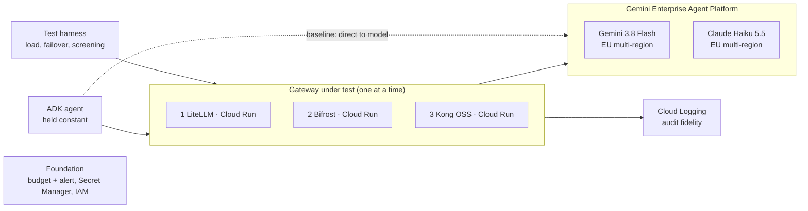
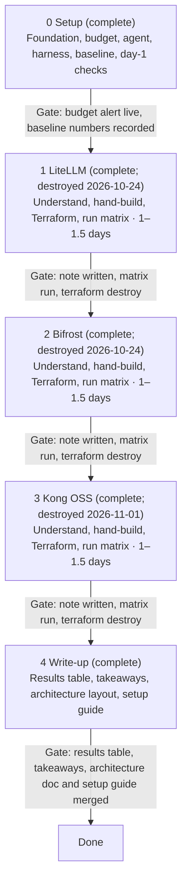

# AI Gateways — Project Plan

Oct 12, 2026 · James Carty

> **Revised Oct 12, 2026 after day-1 research** ([day1-checks.md](day1-checks.md)): scope cut to three OSS gateways; Gemini Agent Gateway and Model Armor moved to a separate project; region moved to `europe-west1` with Claude on the EU multi-region endpoint.

## Overview

This repo builds, runs and breaks three open-source AI gateways on GCP, one at a time, in front of the same ADK agent. The aim is to learn, hands on, how each one is set up and configured and how it handles a request. Running the same tests on each gives something concrete to poke at; it is not meant as a benchmark.

| # | Gateway | Hosting | Why this position |
| --- | --- | --- | --- |
| 1 | LiteLLM (OSS) | Cloud Run | Python with readable source; sets the baseline concepts |
| 2 | Bifrost (OSS) | Cloud Run | Same job in Go, with different design choices |
| 3 | Kong OSS | Cloud Run | API-gateway plugin model and declarative config |

## Goals and non-goals

Success means being able to explain, from hands-on evidence, how each gateway handles a request and where its OSS edition stops.

**Goals**

- Understand each gateway's request path, config model and extension model, recorded as a one-page "how it works" note.
- Run the same seven-test matrix against all three, with a direct-to-model baseline.
- Produce a results table, including an OSS-ceiling table, and a one-page takeaways note on what each gateway turned out to be good at ([results/summary.md](../results/summary.md#across-the-three-gateways), [takeaways.md](takeaways.md)).

**Non-goals**

- Gemini Agent Gateway and Model Armor (separate project).
- MCP or tool traffic, A2A traffic, and client-to-agent ingress. Only agent-to-model traffic is in scope.
- Paid editions, licences, subscriptions or trials of LiteLLM, Bifrost or Kong.
- Soak tests or production-grade load testing.
- Models outside Gemini and Claude on Gemini Enterprise Agent Platform (formerly Vertex AI).

## Scope and requirements

Every gateway goes through the same four-step learning loop and the same seven tests, so the results line up.

**Learning loop, per gateway**

1. Understand: read the architecture docs and the relevant source, then write the "how it works" note.
2. Hand-build: deploy manually. Get one agent-to-Gemini call working, then one agent-to-Claude call.
3. Codify: Terraform it.
4. Test: run the shared matrix and write up what was surprising.

Concepts are added in the same order each time: unified API and request translation, then routing and failover, rate limits and budgets, guardrails, and logging.

**Shared test matrix**

| # | Test | What is measured |
| --- | --- | --- |
| 1 | Overhead | p50/p95 added latency, TTFT when streaming, throughput at modest concurrency, all against direct-to-model |
| 2 | Routing and failover | Gemini to Claude and back, on a forced error or 429 |
| 3 | Cost control | Token budgets and rate limits; whether they are hard or advisory |
| 4 | Inline screening | One shared injection and PII set; each case classed as blocked, logged or invisible |
| 5 | Identity and secrets | Agent-to-gateway and gateway-to-model auth: keys or workload identity |
| 6 | Audit fidelity | Whether the logs can reconstruct a single agent run |
| 7 | OSS ceiling | What each test needed that only the paid tier provides |

**Day-1 checks, before building** (findings in [day1-checks.md](day1-checks.md))

- [x] Region and model availability: `europe-west1` for Gemini; Claude Haiku 5.5 on the EU multi-region endpoint.
- [x] First pass at what each OSS build includes (vendor and third-party sources; to be confirmed hands-on).
- [x] Claude Haiku 5.5 enabled in Model Garden.
- [x] Claude Haiku 5.5 quota on the EU multi-region endpoint: the deployed agent's first call answered.
- [x] Gemini Flash answers: `gemini-3.8-flash` on the `eu` multi-region (it has no `europe-west1` endpoint).
- [x] Baseline recorded with the harness (Oct 14, 2026): see [results/summary.md](../results/summary.md).
- [x] Kong OSS AI Proxy can reach Claude on the Agent Platform: only as a native pass-through, not by translation (2026-10-24; `gateways/kong/NOTES.md`).

## Architecture

One gateway sits between the agent and the model endpoints at a time; everything else stays fixed so the results compare.



The dashed path is the direct-to-model baseline used for the overhead test. Only the foundation, the agent and the harness job persist between phases.

- **Agent:** a small ADK agent (Python) on Cloud Run, with its model endpoint switched by config between direct-to-model and the current gateway.
- **Gateways:** OSS containers on Cloud Run, min-instances 0, in `europe-west1`.
- **Models:** Gemini 3.8 Flash and Claude Haiku 5.5, both on the EU multi-region endpoint (neither has a single-region endpoint), for load tests; larger models for spot checks only.
- **Auth:** each gateway calls the models with a service account; test 5 compares keys with workload identity.

## Repo scaffold

Proposed: a persistent foundation stack, plus one self-contained folder per gateway, so each phase ends with a single `terraform destroy`.

```
ai-gateways/
  foundation/          # persists all project: APIs, budget + alert, service accounts, state bucket
    terraform/
  agent/               # the one ADK agent (Python)
    src/
    terraform/
  gateways/
    litellm/
      NOTES.md         # the "how it works" note
      config/          # gateway config (e.g. config.yaml)
      terraform/       # Cloud Run service, secrets, IAM
    bifrost/           # same shape
    kong/              # same shape (declarative kong.yaml)
  harness/
    load/              # overhead, TTFT, throughput
    failover/          # forced error / 429 scenarios
    screening/         # shared injection + PII cases
    common/            # target config: direct-to-model or a gateway URL
  results/
    raw/<gateway>/     # timestamped raw output, committed
    summary.md         # results table + OSS-ceiling table
  docs/
    takeaways.md
    day1-checks.md
  Makefile             # deploy-<gw>, test-<gw>, destroy-<gw>
```

Tooling:

- Python managed with uv for the agent and the harness, so there is one language outside Terraform.
- Terraform with remote state in a GCS bucket created by `foundation/`, with one state prefix per stack.
- pre-commit running terraform fmt/validate, ruff, and a secret scanner.
- `.gitignore` covering tfstate, `.terraform/`, `.env` and service-account keys.
- The harness reads one target setting, so every test runs unchanged against the baseline or any gateway.

## Milestones

The three gateway phases are estimated at 1–1.5 days each, so roughly 3–4.5 working days plus setup and write-up.



## Risks and decisions

The biggest avoidable risk is cloud spend.

| Risk | Mitigation |
| --- | --- |
| Spend runs away during load or screening runs | Budget and alert before any deploy; Flash and Haiku with low max_tokens; short bursts; destroy each gateway at phase end |
| Results are not comparable across gateways | Same agent, region, models, prompts and harness target setting for every run; raw output committed |
| Claude quota on the EU multi-region endpoint is zero or low | Check and request quota during Setup, before any gateway work |
| Kong OSS cannot reach Claude on the Agent Platform | Checked 2026-10-24: not by translation. Claude goes through Kong as a native `rawPredict` pass-through, and the loss is recorded as an OSS-ceiling result (ADR 0014) |
| OSS features differ from the docs | The OSS-ceiling table records what was actually missing, test by test |

**Decisions**

| Question | Decision | Still to confirm |
| --- | --- | --- |
| Scope | Three OSS gateways. Gemini Agent Gateway and Model Armor moved to a separate project. | |
| Overhead test path | Record both. The main overhead number comes from harness → gateway, compared with harness → model. A smaller end-to-end run goes harness → agent → gateway, compared with agent → model. | Keep agent-path runs short to limit spend |
| Region | Belgium (`europe-west1`) for all deployed resources. Both models through the EU multi-region endpoint (`eu`). | |
| Claude model | Claude Haiku 5.5 (Haiku 4.5 retires from Oct 15, 2026) | |
| Agent hosting | Cloud Run (decided Oct 13, 2026): same platform as the gateways, so the agent→gateway path is identical for all three; repointed by an env var; ID-token auth gives test 5 a clean workload-identity case. Images built by Cloud Build from a repo Dockerfile (no local Docker). | |
| Test harness | Python, run as a Cloud Run job (`agw-harness`) next to the agent and gateways. Targets `direct` (native model APIs), `agent` (ADK) and `gateway` (OpenAI-compatible). One httpx client, warm-up discarded, fixed prompts and caps. See [ADR 0006](decisions/0006-harness-design.md). | |
| Results flow | The job writes raw output to a results bucket; runs are copied into `results/raw/<gateway>/` and committed, headline numbers go in `results/summary.md`. | |
| Baseline pairing | Each gateway run includes a direct baseline measured in the same job: Gemini's latency drifts between and within runs, so comparing with an earlier baseline is unfair. See [ADR 0007](decisions/0007-paired-baselines.md). | Interleave direct and gateway requests |
| Gemini model | `gemini-3.8-flash` (GA Sep 2, 2026) | |
| Thinking | Fixed test condition: Gemini at `LOW` (its floor; it rejects `MINIMAL`), Claude off. Cut Gemini's tokens for a one-line answer from 203 to 54. Via gateways sent as `reasoning_effort: "low"`; whether each gateway honours it is a finding. | |
