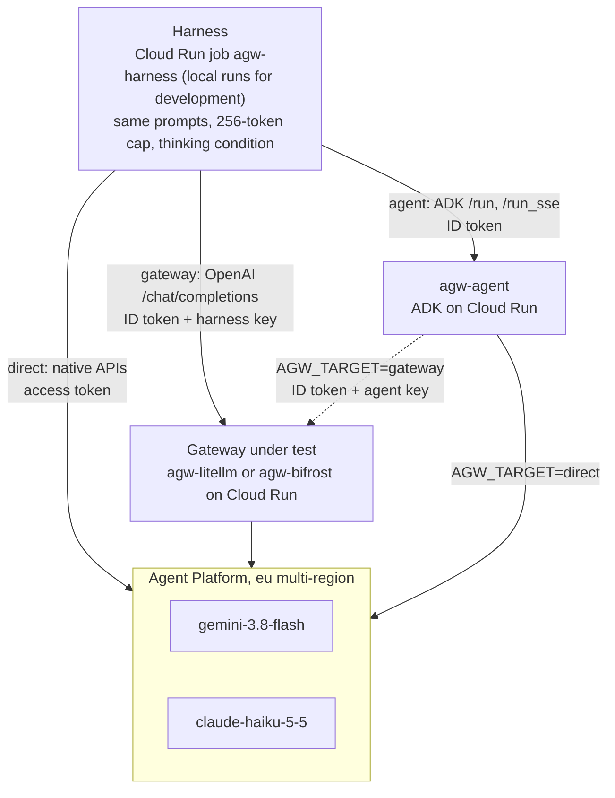

# harness

The load harness: sends the same requests to the direct baseline, the agent, or a gateway, and records one line per request. Recorded runs execute as a Cloud Run job (`agw-harness`) in `europe-west1`, next to what they measure; local runs are for development.

## Architecture



The harness sends the same requests down one path per **target**; only the `agent` target calls the agent, and what sits behind the agent (the models or the gateway) is the agent's own `AGW_TARGET`, not the harness's. `direct` is the baseline, `gateway` measures the gateway's overhead against it, and `agent` is the end-to-end agent path (ADK's own work included). `compare` runs two or more targets side by side in one job; its default, `direct,gateway`, never calls the agent.

Recorded runs execute next to what they measure, in `europe-west1`, so the workstation's network stays out of the numbers.

## What it measures

| Target | Request | Auth |
| --- | --- | --- |
| `direct` | Native APIs on the `eu` multi-region: Gemini `generateContent` / `streamGenerateContent`, Claude `rawPredict` / `streamRawPredict` | ADC access token |
| `agent` | ADK `/run` / `/run_sse` on `agw-agent` (app `gemini` or `claude`) | ID token (the service is IAM-authenticated) |
| `gateway` | OpenAI `/chat/completions` at `AGW_GATEWAY_URL`; with `AGW_GATEWAY_CLAUDE_API=anthropic` (Kong), Claude gets the `direct` target's `rawPredict` request under `AGW_GATEWAY_URL` instead | ID token; with an API key, the key goes in `Authorization` and the ID token in `X-Serverless-Authorization` |

Exit code: non-zero when more than 5% of a run's requests fail (any cell, for `baseline`). Latency percentiles (`latency_s`) cover successful requests; `latency_all_s` also counts failed requests that were sent (e.g. timeouts at 60 s), so a target that fails slow requests fast can't look faster.

Every target gets the same work: the same 10 short prompts (rotated), the agent's two-sentence instruction, a 256-token cap, and the thinking condition (Gemini `LOW`, Claude off; `reasoning_effort: "low"` through gateways). Direct uses native formats on purpose: any translation a gateway does counts as its overhead.

All targets use the same httpx setup: one client per run (per target per cell in `compare`). Credentials are fetched before the clock starts; warm-up requests (10 by default) are sent and discarded. Per request it records latency, time to first token (streams: the first event carrying answer text), status, input/output/thinking tokens and any error (its first 500 characters). Error text is committed with the results, so credentials a gateway echoes in it (key hashes, raw keys, Google API keys, ID and access tokens) are redacted before it is cut, after the request is timed.

## Output

```
<results>/<run_id>/
  meta.json                                  # image, models, location, caps, grid
  <target>-<model>-<stream|nostream>-c<N>.jsonl       # one line per measured request
  <target>-<model>-<stream|nostream>-c<N>.summary.json  # p50/p95/p99, TTFT, req/s, errors
  summary.md                                 # baseline and compare: tables (compare adds a paired one)
```

`python -m agw_harness.cli report <run_dir>` prints the same tables for any run directory, including one copied into `results/raw/`: rows in the run's own order, and the "thinking > 0" column recounted from the `.jsonl` lines (so it works for runs that predate it). On the native paths (`direct`, `agent`) a missing thinking count means zero (Gemini omits zeros; Claude runs without thinking); through a gateway it shows as `unknown`, because an OpenAI-format gateway may drop the field.

## The baseline grid

`baseline` runs both models × non-streaming and streaming × concurrency 1 and 5: 200 requests per cell for `direct`, 50 for `agent` (1,600 + 400 requests).

## Paired comparisons

Gemini's latency drifts by seconds over minutes (ADR 0007), so a gateway is only compared with a direct baseline measured at the same time. `compare` runs both in one job:

```bash
python -m agw_harness.cli compare --targets direct,gateway   # defaults: --n 100 --block 25 --concurrency 1,5 --warmup 10
```

- **Grid:** both models × non-streaming and streaming × each concurrency (8 cells by default, about 1,800 requests with warm-ups; about 20 minutes as a job against LiteLLM, 26 against Bifrost).
- **Alternating blocks (ABBA):** within a cell, the targets take turns in blocks of `--block` requests until each has sent `--n`, and the order reverses every block (direct, gateway, gateway, direct, …; the starting target also flips from cell to cell). Each target's requests then sit at the same average time in every cell, so drift lands on both alike. The order of every block is recorded (`block_orders`).
- **Warm-ups:** `--warmup` discarded requests before each target's first block in a cell, then `concurrency` more before each later block. Each target keeps one HTTP client for the cell, but its idle connections expire while the other target runs (and so may the gateway's own connections to the models); the per-block warm-up reopens them, so no measured request pays a new connection.
- **Pre-warm:** before anything is measured, one request per model goes to each Cloud Run target (`gateway`, `agent`), with a 180 s timeout and up to three tries, 5 s apart. A cold gateway can take most of a minute to start, past the 60 s request timeout, and LiteLLM's first Claude call on a new instance takes about 15 s. Every try is recorded under `prewarm` in `meta.json` and in `summary.md`; the first try is a cold-start data point. A target that never answers gets a `WARN` line, and the run carries on.
- **Output:** the usual per-run files for each target, plus `summary.md` with a paired table (each target's p50, p95, TTFT p50 and error rate against the first target's, with the differences), the full table, and the pre-warm log. req/s there is summed over blocks, each of which drains to zero, so it compares between the targets of one run, not with `load` or `baseline`. A cell that crashes shows as `0/0` rows and makes the run exit non-zero.
- **The agent path:** `--targets direct,gateway,agent` adds it (point the agent at the gateway first, and pass `--agent-backend gateway` so its missing thinking counts read as unknown, not zero).

## Scenarios (tests 2 to 6)

`scenarios <file>` sends a file of named cases to the gateway and records what happened, for behaviour rather than latency: which model answered, the status, chosen response headers, and whether each case's expectation held.

```bash
python -m agw_harness.cli scenarios scenarios/litellm/failover.json
```

- **Files** live under `scenarios/<gateway>/` (they ship in the image), one per test (test 3 has several, one per set of key limits; tests 3, 5 and 6 also have `run-*.sh` wrappers that mint throwaway keys and, for test 6, collect the audit trail with `audit_trail.py`, whose generic parts live in `src/agw_harness/trail.py`; all local-only), because each gateway triggers failover, limits, screening or auth failures its own way. Each case is the measured gateway request (same instruction, token cap and thinking condition for its `kind`) with `model` replaced, the user message replaced by `prompt` if given, and `body` merged in, sent `repeat` times one after another, or all at once with `concurrent: true`; `pause_s` waits before a case (e.g. for a rate-limit window to pass); `headers` adds request headers (test 6's join keys, e.g. Bifrost's `x-bf-session-id`), and names or values that look like credentials are rejected (use `id_token` and `api_key`). Unknown keys are rejected, so a typo can't pass as a match.
- **Shared cases (test 4):** `cases_from` loads a gateway-neutral case set (`scenarios/screening-cases.json`) and expands it once per `matrix` entry (model and kind), with `case_defaults` applied. Those cases carry `ideal` (block, mask or allow) and, optionally, `sensitive` text, and each attempt gets a `classification`: blocked, masked (the file's `mask_marker` came back), leaked, withheld, passed or error. `summary.md` then opens with the classes per group and model. A `canary` is a case-sensitive regex that only matches if the model obeyed an injection.
- **Credentials (test 5):** a case can drop the ID token (`id_token: false`) or replace the gateway key (`api_key`: `none`, `env:NAME` for a key minted for the run, or a deliberately invalid literal). A missing `env:` variable is recorded as a credentials error and the request isn't sent.
- **Expectations** (`expect`): `status`, `model` (the model that answered), `headers`, and case-insensitive `answer_contains`, `answer_not_contains`, `error_contains`, `error_not_contains` (error text is checked after credentials are redacted). An expected 2xx also needs a non-empty answer and no error mid-stream.
- **Output:** `outcomes.jsonl`, written as each attempt finishes (status, latency, answering model, answer, recorded headers, the full error body up to 8,000 characters; credentials in it and in the recorded headers are redacted as above), and `summary.md` (one row per case). `meta.json` has the git commit and `--note` (say which gateway settings were live). A mismatch with a case's `expect` is a finding, not a failure: the command exits 0.
- **Per-gateway instructions,** including how to do the same by hand: `scenarios/litellm/README.md`, `scenarios/bifrost/README.md`, `scenarios/kong/README.md`.

## Develop

```bash
cd harness
export UV_PROJECT_ENVIRONMENT=/var/tmp/agw-harness-venv   # home is gcsfuse; see AGENTS.md
uv sync --locked
uv run pytest

# A few real requests (needs gcloud auth application-default login):
AGW_PROJECT=my-gcp-project PYTHONPATH=src uv run python -m agw_harness.cli \
  load --target direct --model gemini --n 2 --warmup 0
```

**ID tokens for the agent and gateway targets** come from `AGW_ID_TOKEN_SOURCE`: `metadata` (service-account credentials, falling back to `gcloud auth print-identity-token` for user credentials), `gcloud` (always the gcloud user), or `auto`, the default. `auto` picks `metadata` only in the `agw-harness` job (`CLOUD_RUN_JOB` set) or with a service-account key file in `GOOGLE_APPLICATION_CREDENTIALS`, and `gcloud` everywhere else: on a cloud workstation or a Compute Engine VM the metadata server would mint tokens for the machine's own service account and get 403s. Each run records the source it used in `meta.json` (`id_token_source`).

## Build, deploy, run

Apply order on a fresh project: `foundation/`, then `agent/` (the job reads its URL), then `harness/`. The build script needs `foundation/terraform` initialised (it reads its outputs) and refuses uncommitted changes under `harness/`, so commit first.

```bash
scripts/build-image.sh harness          # from the repo root; prints the image = …@sha256 line

cd harness/terraform
cp terraform.tfvars.example terraform.tfvars   # first time: set image
terraform init -backend-config=../../foundation/terraform/backend.hcl
terraform apply
```

The job's service account (`agw-harness`) must be in the agent's `invoker_members` (`agent/terraform/terraform.tfvars`), and in the gateway's for gateway runs.

**Gateway key:** for gateway runs the job sends a virtual key of its own (`agw-litellm-harness-key`, see `gateways/litellm/README.md`; `agw-bifrost-harness-key`, see `gateways/bifrost/README.md`), not an admin credential. LiteLLM checks the master key in memory but looks virtual keys up in Postgres (cached), so a virtual key keeps the harness path's gateway work the same as the agent's. Set `gateway_api_key_secret` in `terraform.tfvars`; the secret is read when an execution starts. On LiteLLM the key's `max_budget` (see the gateway README) accumulates across runs; if a run starts failing with 4xx from the gateway, check the key's spend in LiteLLM.

**Timeout:** `timeout_s` (default 7200) caps an execution; a timeout kills the job with no retry, and `summary.md` (rewritten after every cell) keeps what finished.

```bash
# A small check first: 2 direct requests, no warm-up.
gcloud run jobs execute agw-harness --project my-gcp-project --region europe-west1 --wait \
  --args=load,--target,direct,--model,gemini,--n,2,--warmup,0

# The full baseline (default args), about 30-40 minutes:
gcloud run jobs execute agw-harness --project my-gcp-project --region europe-west1 --wait

# A gateway phase: set gateway_url and gateway_api_key_secret in terraform.tfvars and apply,
# then a paired direct-versus-gateway run (about 20 minutes with the defaults).
# gcloud splits --args on commas, so ^@^ switches the separator to @ to keep direct,gateway whole.
# --args also rejects repeated items: write options as --flag=value (--n=2@--block=2), not --n@2@--block@2.
gcloud run jobs execute agw-harness --project my-gcp-project --region europe-west1 --wait \
  --args=^@^compare@--targets@direct,gateway

# Copy a run into the repo and commit it:
gcloud storage ls gs://my-gcp-project-ai-gateways-results/
gcloud storage cp -r gs://my-gcp-project-ai-gateways-results/<run_id> results/raw/baseline/
```
